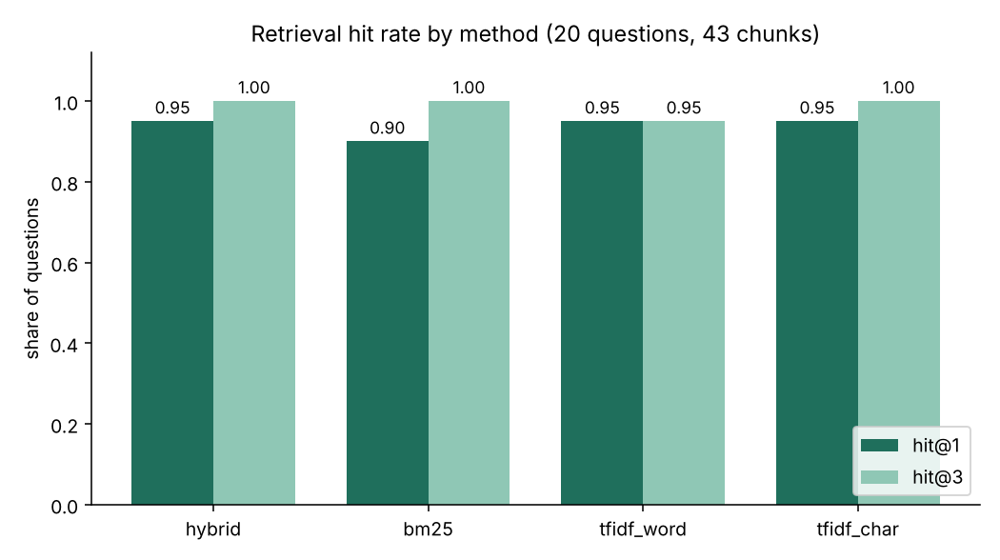
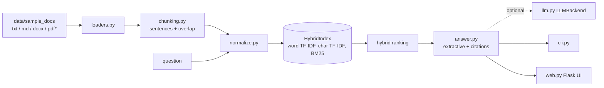
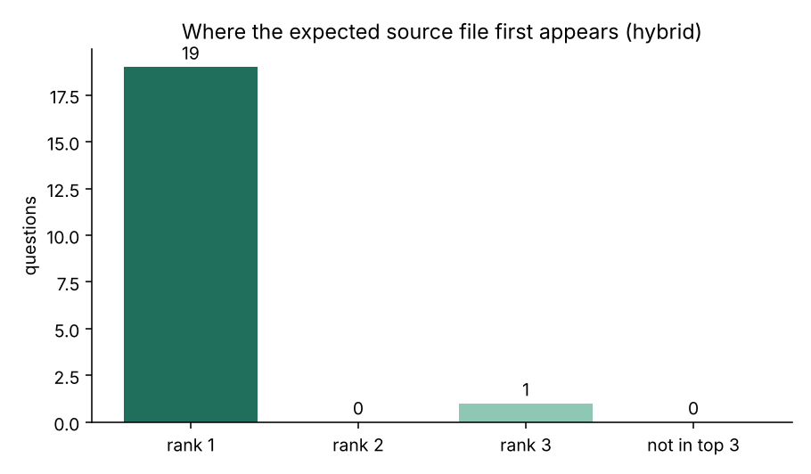

# Arabic AI Knowledge Assistant

Question answering over a folder of Arabic and English documents using classic retrieval only:
Arabic-aware normalisation, sentence-aware chunking, TF-IDF (word + character n-grams), a hand-written BM25
and a hybrid score. Answers are **extractive**: the text is copied from the documents and every answer carries
citations (file, page/paragraph, score). **No LLM is required** and nothing touches the network.

**ملخص بالعربية:** مساعد معرفي للإجابة عن الأسئلة من مستندات عربية وإنجليزية (txt وmd وdocx، وpdf عند توفر المكتبة الاختيارية). يطبّع النص العربي (إزالة التشكيل والتطويل وتوحيد الألف والياء والتاء المربوطة والأرقام الهندية)، ويقسّم المستندات إلى مقاطع مع تداخل بين الجمل، ثم يبحث بمزيج من TF-IDF وBM25. الإجابات مقتطفة حرفيًا من المستندات مع ذكر المصدر ورقم الفقرة أو الصفحة والدرجة، ولا يحتاج المشروع إلى نموذج لغوي. التقييم أُجري على مجموعة صغيرة جدًا (5 ملفات و20 سؤالًا)، فالأرقام توضّح عمل الكود ولا تثبت جودة عامة.



## Features

- **Loaders:** `.txt`, `.md`, `.docx` (zipfile + XML, no dependency) and `.pdf` only when `pypdf` is importable (it is optional and **not** used in the tests or demo here).
- **Arabic normalisation:** removes tashkeel and tatweel; folds alef variants, alef maksura and taa marbuta; hamza-on-waw/yaa; converts Arabic-Indic digits to ASCII; light prefix/suffix stemming and stopword lists (Arabic and English).
- **Chunking:** whole sentences packed up to 450 characters with one sentence of overlap; headings start a new section; each chunk remembers file and `paragraph N` / `page N`.
- **Retrieval:** word TF-IDF, character 3-5-gram TF-IDF (scikit-learn, cosine), BM25 written from scratch, and a hybrid (0.4 BM25 max-normalised + 0.3 word + 0.3 char).
- **Answers:** the best sentences of the top passage plus the top-k cited passages; below a 0.12 hybrid score the assistant says nothing relevant was found.
- **Optional LLM hook:** abstract `LLMBackend` plus a documented stub (`ExampleHTTPBackend`, not implemented). Tests use only a fake backend.
- **Interfaces:** argparse CLI (`index`, `ask`, `eval`, `serve`) and a Flask UI with `dir="auto"` per text block so Arabic renders right-to-left.

## Architecture



\* PDF only if `pypdf` is installed.

## Quickstart

```bash
python -m pip install -r requirements.txt
python -m knowledge_assistant index data/sample_docs
python -m knowledge_assistant ask "What is the 3-2-1 backup rule?"
python -m knowledge_assistant serve --docs data/sample_docs   # http://127.0.0.1:5000
python scripts/demo.py                                        # questions + evaluation + PNG charts
python -m pytest -q
```

Real output of `python -m knowledge_assistant ask "ما هي قاعدة النسخ الاحتياطي 3-2-1؟" --docs data/sample_docs`:

```text
Q: ما هي قاعدة النسخ الاحتياطي 3-2-1؟

Answer: احتفظ بنسخ احتياطية وفق قاعدة 3-2-1: ثلاث نسخ من بياناتك، على نوعين مختلفين من وسائط التخزين، ونسخة واحدة خارج الموقع أو غير متصلة بالشبكة. تحميك النسخ الاحتياطية من برامج الفدية وأعطال الأجهزة والحذف بالخطأ. [1]

[1] cybersecurity_basics_ar.md | paragraph 13 | score 0.662
[2] cybersecurity_basics_en.md | paragraph 13 | score 0.234
```

(Passage text lines omitted here for brevity; the CLI prints them.) Output of `python scripts/demo.py` for an English question:

```text
Q: How do I stop pandas from duplicating rows after a merge?
A: Use `merge()` with an explicit `how` argument and the `validate` option, for example `validate="many_to_one"`, so pandas raises an error if the keys are not unique as expected. After a merge, compare the row count with the original, because an unexpected increase usually means duplicate keys. [1]
   [1] python_data_analysis_tips_en.md | paragraph 12 | score 0.616

Q: How do I cook kabsa?
A: No sufficiently relevant passage was found in the indexed documents.
```

`index` on the sample folder: 5 files, 43 chunks. "Paragraph N" counts non-empty blocks in the file, headings included.

## Evaluation

`data/eval_questions.json` holds 20 questions (12 English, 8 Arabic) with an expected source file and an expected phrase.
**hit@k (source)** = the expected file appears among the top-k passages; **passage hit@k** = additionally the expected phrase is inside one of those passages.

| Method | source hit@1 | source hit@3 | passage hit@1 | passage hit@3 |
|---|---:|---:|---:|---:|
| **hybrid** | **0.95** | **1.00** | 0.90 | 0.95 |
| bm25 | 0.90 | 1.00 | 0.90 | 0.95 |
| tfidf_word | 0.95 | 0.95 | 0.90 | 0.90 |
| tfidf_char | 0.95 | 1.00 | 0.90 | 0.95 |



**Read this carefully:** the corpus is tiny (5 files, 43 chunks, three topics), so chance is already high and the methods are statistically indistinguishable (one question = 5 points). The questions were written by the project author who had read the documents, and they have not been tuned afterwards but are not independent either. The only passage-level miss for hybrid is a "same results every time" reproducibility question that retrieves a different section. Raw numbers: [`docs/eval_results.json`](docs/eval_results.json). The "no answer" threshold was checked on four off-topic queries only (all rejected); this is not a calibrated result.

## Project structure

```text
knowledge_assistant/  normalize, loaders, chunking, retrieval (BM25 + hybrid), answer, llm, evaluate, charts, web, cli
data/sample_docs/     5 original synthetic docs: cybersecurity basics (AR/EN), Vision 2030 general facts (AR/EN), Python data analysis tips (EN)
data/eval_questions.json   20 question/expected-source pairs
scripts/demo.py       one-command demo, writes docs/*.png and docs/eval_results.json
tests/                32 pytest tests
docs/                 evaluation charts and results
```

## Testing

```bash
python -m pytest -q      # 32 passed
```

Covers normalisation rules, tokenisation, loaders (including a generated `.docx`), chunk overlap/locators, BM25 against a hand computation, hybrid score composition, Arabic queries with diacritics and Arabic-Indic digits, citations, the no-answer path, the LLM interface (fake backend only), index save/load, CLI, Flask routes and HTML escaping, evaluation and PNG output.

## Limitations

- **Tiny, synthetic corpus.** Evaluation numbers are not evidence of general quality.
- **Lexical retrieval only:** no semantic embeddings, so paraphrases without shared words can be missed, and an Arabic question will not retrieve an English passage by meaning (it only did so above through shared tokens like "3-2-1").
- **Extractive answers** copy sentences; they do not synthesise across passages. Sentence choice is a simple term-overlap heuristic.
- The Arabic stemmer is a few prefix/suffix rules, not a morphological analyser.
- PDF loading is implemented but **untested here** because `pypdf` was not installed. Scanned PDFs would need OCR.
- The saved index uses joblib (pickle): only load index files you created.
- The Flask server is the development server and has no authentication.
- The sample documents are generic summaries, not official sources; check Vision 2030 figures against government publications.

## Roadmap

- Optional embedding retriever behind the same interface, compared on a larger corpus.
- A bigger, independently written evaluation set.
- Real `LLMBackend` implementations with citation checking.

## Built with AI assistance

This project was built with the help of an AI assistant (Claude). The code, tests, sample documents and README were drafted with AI help; the numbers above are pasted from real runs of this repository. Review it before relying on it.

## License

MIT, see [LICENSE](LICENSE).
